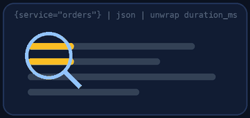
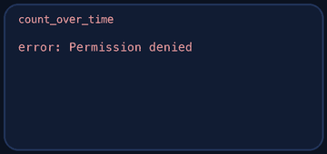
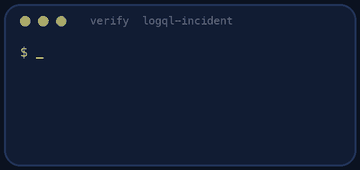

<p align="center"></p>

| | |
|-|-|
| **Time** | 90-105 min |
| **Cost** | free on your own machine |
| **You need** | Docker, Python 3 with PyYAML (`python3 -m pip install pyyaml`) and a terminal (on Windows use WSL) |

## How this lab works

1. **Fork** this repository to your own GitHub account (button at the top right).
2. Clone **your fork** in your Ubuntu environment (WSL on Windows, your OrbStack machine on Mac).
3. Read the lab below (the same text is in [`LAB.md`](LAB.md)) and follow the mission.
4. Answer the questions in [`SUBMISSION.md`](SUBMISSION.md). Where a question asks for output, paste it in a code block. No screenshots needed.
5. Commit and push. Open the **Actions** tab of your fork (click *I understand my workflows, go ahead and enable them* the first time). The **Lab check** shows what is still missing.
6. When the check is green, **submit the URL of your fork** in the course platform.

> [!NOTE]
> The check only looks at your answers and any files the lab asks you to commit. Your instructor reads your work and may ask you to explain any line.

<p align="center"></p>

## 🎬 The situation

<p align="center"></p>

This is a pairing session. Tomás is the on-call engineer who was away when it happened, and Support has just forwarded three angry e-mails to both of you:

> *"Beanie failed my orders for about twenty minutes this afternoon. How many customers were hurt, which service was it, and was it only the ones who wrote to us?"*

Tomás shrugs: *"Nobody wrote anything down, and I was not there. But the logs were kept. Two hours of them, five services, all in Loki. You drive, I will ask the questions."*

A log store is not a place you read, it is a database you **ask**. LogQL, its query language, works in three layers: pick the **streams** by label, **filter and parse** the lines, then turn what is left into **numbers**. By the end you will have answered ten precise questions and written the incident report that should have existed at 15:00.

> [!IMPORTANT]
> **Your mission**
> - Start Loki and Grafana with two hours of Beanie logs in them
> - Answer ten questions with LogQL: error counts per service, percentiles from log fields, the customer with most failures, SMS per country parsed from plain text
> - Write `REPORT.md` from the evidence: what, when, who, and what logs cannot tell you
> - Tear down and prove it

**Time:** 90-105 min | **Cost:** free | **You need:** Docker, Python 3 with PyYAML (`python3 -m pip install pyyaml`) and a terminal. On Windows use WSL.

<p align="center"></p>

## Part 0 - Open the logs

Fork this repository, clone your fork and run:

```bash
./setup.sh
```

It starts Loki and Grafana in containers and pushes about ten thousand log lines. Open Grafana at http://localhost:3198 (no login) and go to **Explore**, data source **Loki**, switch the editor to **Code** and run:

```text
{app="beanie"}
```

Look at one line from `gateway`, one from `orders` and one from `notifications`. Four services log **JSON**, one logs **plain text**. Every stream has two labels: `app="beanie"` and `service`. Everything else (the level, the customer, the duration) is **inside the line**.

> [!NOTE]
> **Think** Why did the people who set up logging put only `app` and `service` in labels, and not `level`, `customer` or `trace_id`? What would happen to Loki's index, and to its cost, if `trace_id` (a different value on every request) were a label?

<p align="center"></p>

## Part 1 - Three layers of LogQL

<p align="center"></p>

1. **Select streams** with label matchers: `{service="orders"}`, `{app="beanie", service=~"orders|payments"}`. This is the fast part: it uses the index.
2. **Filter and parse the lines**, left to right, like a pipeline:
   - `|= "card_declined"` keeps lines containing the text (`!=` drops them, `|~` is a regular expression);
   - `| json` turns a JSON line into **labels you can filter on**: `| json | level="error"`;
   - `| pattern "sms sent country=<country> order=<_>"` and `| regexp "..."` do the same for plain text.
3. **Make numbers** from what is left:
   - `count_over_time(<stream selector and pipeline> [5m])` counts lines in a window; `rate(...)` is the per-second version;
   - `| unwrap duration_ms` turns a numeric field into a value, so that `quantile_over_time(0.95, ... | unwrap duration_ms [2h])`, `max_over_time`, `avg_over_time` work;
   - then the familiar `sum by (label) (...)`, `topk`, `count`, division.

For one number at one moment, use the **Instant** query type in Explore and set the time range so that it covers the data. A range like `[2h]` looks back from the evaluation time.

> [!NOTE]
> **Predict** `{service="orders"} | json | level="error"` and `{service="orders"} |= "error"`: which returns more lines, and what would each also match that you did not want? Run both and compare the counts.

<p align="center"></p>

## Part 2 - The ten questions

Open `queries.yaml`. Each question says what to compute and at which moment (`end` is just after the last log line; `start+55m` is 55 minutes after the first). Write one expression per question. Work in Explore, then paste the working query into the file.

Things people trip over:

- **Too many series.** `| json` makes *every* field a label, so a `sum by (...)` over an unwrapped field can create one series per request. Always end with an explicit `by (service)` (or a `sum by` of the label you want) so that only the labels you ask for survive.
- **Counting distinct things.** There is no `distinct`. `count(sum by (trace_id) (...))` counts the series, and each series is one distinct `trace_id`.
- **Plain-text lines** have no labels to parse: `pattern` is the readable choice; `regexp` is the powerful one.
- **A ratio** of two `count_over_time` needs matching label sets on both sides, usually after `sum(...)` on each.

<p align="center"></p>

## Part 3 - Write the report Tomás needs

Using your queries (change the evaluation time and the filters as you explore), write `REPORT.md`, four short sections: **what happened**, **when and for how long**, **who was affected and how badly**, and **what you could not tell from logs alone**. Include numbers and times from your queries. A good test: a person who was not there should know whether to worry.

You will find two incidents in the data, only one of which caused errors. Find the second by looking at `warn` lines and `duration_ms` of the `menu` service.

> [!NOTE]
> **Think** Which of your queries would you turn into an alert (Loki has a ruler that evaluates LogQL like Prometheus rules)? Why is "count of ERROR lines of orders in 5 minutes above N" worse than an alert on a **metric** the service exports? What would you still use the logs for once the alert fires?

<p align="center"></p>

## Part 4 - Prove it

<p align="center"></p>

```bash
./verify.sh
```

It evaluates each of your ten expressions against Loki at the right moment and compares the **result** with the correct one (within 1%). Any correct query passes; a constant or the wrong selector does not. It also reads your report. Fix what is red and run it again until it ends with **ALL CHECKS PASSED**.

> [!TIP]
> **Stuck?** `Loki says: parse error`: the message names the position; remember that the range `[2h]` goes **inside** the function and a `by (...)` for range aggregations goes **after** it. `too many series` / `maximum of series reached`: you aggregate by a high-cardinality label; add `sum by (x)` first. No data: the evaluation time is outside the logs, or a label matcher is wrong (`service` values are `gateway`, `menu`, `orders`, `payments`, `notifications`). Several series where one is wanted: you forgot `by (service)` on an `unwrap` query or a `sum(...)` around a `count_over_time`.

<p align="center"></p>

## Level up (optional)

- Turn question 1 into a **recording rule** in Loki's ruler configuration, and into an alert with a `for:` of two minutes.
- Use `logcli` instead of Grafana: `logcli query '{service="orders"}' --since=2h --limit=20`. When is a CLI better than a UI at 3 a.m.?
- Add `| line_format "{{.customer}} {{.msg}}"` to make a human-readable view of the error lines.
- Compare the same question answered from logs (question 8) with the same answered from the Prometheus metrics of the PromQL gym. Which one would you trust for an SLO?

<!-- teardown:start (generated by labs.py, do not edit) -->
## Tear down (mandatory)

<p align="center"></p>

Resources left behind cost money, keep doors open and pollute the next lab. Removing what you created is part of the job, so it is part of the submission: **you must prove it is gone**.

Do this **last**, after you have pasted your `verify` output into `SUBMISSION.md` (once you tear down, the lab can no longer be verified).

1. Run `./teardown.sh`. It removes the Loki container and the generated data.

Then run the proof:

```bash
./verify-teardown.sh
```

It prints a list of checks and must end with **TEARDOWN VERIFIED**. If it reports leftovers, remove them and run it again. Paste the full output in your submission.
<!-- teardown:end -->

<!-- submission:start (generated by labs.py, do not edit) -->
## 📬 Submission

Answer the questions in `SUBMISSION.md` in **your fork** (paste output in code blocks where asked), push, then submit the **URL of your fork**.

**Files to commit**

- `queries.yaml`: your ten LogQL expressions
- `REPORT.md`: the incident report, written from your queries

**Questions to answer**

1. Paste your queries for questions 1 and 4. Explain, in your own words, the difference between a **label** (`{service="orders"}`), a **line filter** (`|= "card_declined"`) and a **parsed field** (`| json | level="error"`). Which is fastest, and why does Loki not index the line itself?
2. Paste your query for the 95th percentile of `duration_ms`. What does `unwrap` do, and why is the result different from the average? Which function turned a stream of lines into numbers?
3. Question 7 reads text that is not JSON. Paste your `pattern` or `regexp` query. When is `pattern` better than `regexp`, and why should the best answer be "log JSON in the first place"?
4. Paste your question 9 query. Why does an aggregation by `trace_id` risk "too many series", and what did you do about it? What is high cardinality, and which of these would you never make a label: `service`, `level`, `trace_id`, `customer`?
5. Paste your REPORT.md. Which three facts (service, window, size) are the heart of it? Which of your queries would you turn into a log-based alert, and what could you NOT know from logs alone that metrics or traces would have told you?
6. Paste the output of `./verify.sh`. It must end with **ALL CHECKS PASSED**.
7. **Tear down.** Paste the output of `./verify-teardown.sh`. It must end with **TEARDOWN VERIFIED**.
<!-- submission:end -->
